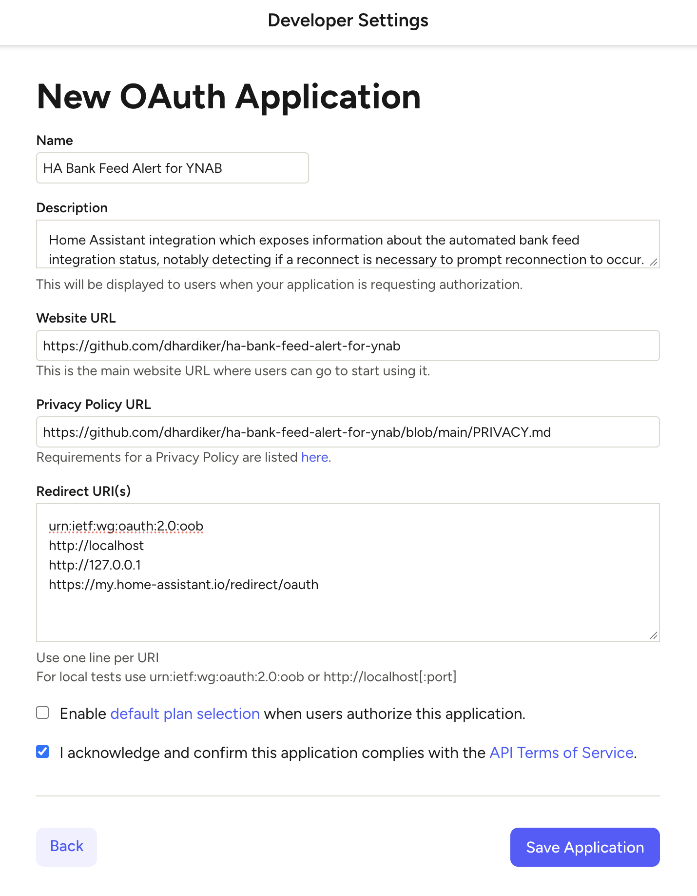

# Bank Feed Alert for YNAB

A Home Assistant integration that tells you when YNAB's bank connections need
reconnecting, before weeks of transactions go missing.

YNAB's Direct Import keeps your accounts in step with the bank, until a connection
stops working. That happens on a schedule in the UK and Europe, where open-banking
consent has to be renewed (often every 90 days). When it happens, YNAB marks the
account in the app, but it doesn't email you. Transactions quietly stop arriving
until you next look.

This integration reads that mark from YNAB's API and tells Home Assistant:

- **A repair** appears under *Settings → Repairs*: "YNAB bank connections need
  reconnecting", listing the accounts. If they are still broken after a few days
  (default 3), it becomes an error. It clears itself once YNAB reports the
  connections healthy.
- **Entities** let you notify, escalate and show it on dashboards however you like.

It asks YNAB for **read-only** access, through **your own** YNAB OAuth application.

## What you get

One device per YNAB plan (named after the plan), with:

| Entity | What it says |
| --- | --- |
| `binary_sensor.<plan>_bank_feeds_need_reconnecting` | On while any linked account's bank connection is in error. Attributes: `accounts` (names) and `broken_since`. |
| `binary_sensor.<plan>_reconnect_overdue` | On once a connection has been broken for the escalation period (option, default 3 days). |
| `binary_sensor.<plan>_<account>` | One per linked account: on when that account needs reconnecting. Attributes: `in_error_since`, `last_reconnected`, `expected_lapse`. Unavailable once the account is closed or unlinked. |
| `sensor.<plan>_broken_bank_feeds` | How many linked accounts are in error. |
| `sensor.<plan>_broken_since` | When the longest-running current error was first seen. |
| `sensor.<plan>_next_reconnection_due` | When the next healthy connection is projected to lapse: its last reconnection plus the *connection lifetime* option. Unknown until a reconnection has been seen or marked. |
| `sensor.<plan>_last_checked` | When YNAB last answered (diagnostic): proof the watch itself is working. |

**How often it checks.** Every 4 hours while all is well (an option). Every 30 minutes while a
connection is broken, and from 2 days before a projected lapse until a day after it. It also
retries a failed check after 30 minutes. Each check is a single request; YNAB allows 200 an hour.

**What "since" means.** YNAB doesn't say when a connection broke, so "since" means the first
check that saw it.

**Projected lapses.** YNAB doesn't say when a connection will expire either. The integration
notes when each one comes back after an error (`last_reconnected`) and adds the
*connection lifetime* to project the next lapse. If you renew a connection early, or reconnected
before installing this, use the **Mark reconnected** action so the projection starts from then.

## Set up

Do these in order. As soon as you add the integration, Home Assistant asks for your YNAB
application's details, so create that first.

### 1. Create a YNAB OAuth application

In YNAB go to *Account Settings → Developer
Settings* (<https://app.ynab.com/settings/developer>) and click *New Application*:

| Field | What to enter |
| --- | --- |
| Name | A name that doesn't start with "YNAB" (YNAB's terms reserve that; "… for YNAB" is fine). For example *HA Bank Feed Alert for YNAB*. You'll see it when you authorise. |
| Description | For example: *Home Assistant integration that watches the status of YNAB's bank connections and alerts when one needs reconnecting.* |
| Website URL | `https://github.com/dhardiker/ha-bank-feed-alert-for-ynab` |
| Privacy Policy URL | `https://github.com/dhardiker/ha-bank-feed-alert-for-ynab/blob/main/PRIVACY.md` |
| Redirect URI(s) | `https://my.home-assistant.io/redirect/oauth`: the only one needed. It's Home Assistant's own redirect service, which hands your browser back to *your* Home Assistant, so YNAB never needs to reach your home network. If you've disabled My Home Assistant (it's part of `default_config`), use your instance's URL plus `/auth/external/callback` instead. |
| Default plan selection | Leave off. The integration asks which plan to watch. |
| Terms of Service | Tick to confirm. The integration only reads, and keeps nothing outside your Home Assistant ([PRIVACY.md](PRIVACY.md)). |



*The example also lists the local-testing redirect URIs (`urn:ietf:wg:oauth:2.0:oob`,
`http://localhost`, `http://127.0.0.1`). They aren't needed, and you can delete them.*

Save it and keep the **Client ID** and **Client Secret** to hand (a password manager is a
good place).

**Every installation uses its own OAuth application.** There is no shared app or
client secret behind this project. New YNAB applications start in a "restricted mode"
that allows 25 users *other than the owner*, and you are the owner of yours, so the
limit never comes into it. It also means no request ever goes through anyone but YNAB.

### 2. Install

**HACS** (shown as *Marketplace* in recent Home Assistant versions): open its ⋮ menu →
*Custom repositories* (or *Add from link*), and add
`https://github.com/dhardiker/ha-bank-feed-alert-for-ynab` as an *Integration*. Then find
**Bank Feed Alert for YNAB** in the HACS / Marketplace list (not under *Settings → Devices &
services* yet), download it, and restart Home Assistant if asked.

**Manual:** copy `custom_components/bank_feed_alert_for_ynab/` into your
`config/custom_components/` and restart.

Requires Home Assistant 2025.2 or later.

### 3. Add it and sign in

*Settings → Devices & services → Add integration → Bank Feed Alert for YNAB* (newer versions may
offer this straight after installing). Home Assistant first asks for **application
credentials**:

| Field | What to enter |
| --- | --- |
| Name | `HA Bank Feed Alert for YNAB`. It's only Home Assistant's label for these credentials, shown in its *Application Credentials* list. Home Assistant's dialog asks for it, and the integration can't fill it in for you. |
| OAuth client ID | The **Client ID** of the application from step 1, shown in YNAB's Developer Settings. |
| OAuth client secret | Its **Client Secret**, from the same page. |

Then you're sent to YNAB to approve **read-only** access. If you have more than one plan, pick
the one to watch, and add the integration again for another.

### Options

*Configure* on the integration. Each option is kept within sensible bounds:

| Option | Default | Range | What it does |
| --- | --- | --- | --- |
| Escalate after (days) | 3 | 0–30 | When the repair becomes an error and `reconnect_overdue` turns on. 0 means straight away. |
| Check every (hours) | 4 | 1–24 | How often to ask YNAB while all is well. The faster 30-minute rate is fixed. |
| Connection lifetime (days) | 90 | 0–365 | How long your bank connections last. 90 suits UK and EU banks. 0 switches projection off, which suits banks that don't lapse on a schedule (most in the US). |

### Mark reconnected

`bank_feed_alert_for_ynab.mark_reconnected`: target an account's sensor
to restart that account's clock, or the plan's *Bank feeds need reconnecting* sensor for all of
them. `when` defaults to now.

If YNAB ever stops accepting the authorisation, Home Assistant asks you to sign in
again; the alert history is kept.

## Learning when connections lapse

YNAB doesn't publish how long a bank connection lasts, so the integration records every break
and reconnection to find out. Each is bracketed between the last check that saw the old state
and the first that saw the new one: 30 minutes apart while a connection is broken or near a
projected lapse, a few hours otherwise. From a reconnection to the next break, that gives a
lifetime with error bars. After a cycle or two you can tell whether it's 90 days to the minute,
or "day 90 at a fixed time".

- **Download diagnostics** on the integration: `history` lists the events (up to 200 are kept
  across restarts), and `cycles` lists the lifetimes they imply (`lifetime_min_hours`,
  `lifetime_max_hours`).
- **Event** `bank_feed_alert_for_ynab_connection_changed` fires on every change, with `plan`,
  `account`, `change` (`broke`, `reconnected` or `marked`), `after`, `by` and, for a break,
  the lifetime bounds. Use it to log changes somewhere permanent.
- **Logs** at `info` level:
  `logger: {logs: {custom_components.bank_feed_alert_for_ynab: info}}`.

If you learn your bank's pattern, please share it in an issue (the timings, not the names). It
may let the projection get sharper for everyone.

## Example automations

Tell your phone as soon as something breaks:

```yaml
automation:
  - alias: "YNAB bank connections need reconnecting"
    triggers:
      - trigger: state
        entity_id: binary_sensor.home_bank_feeds_need_reconnecting
        to: "on"
    actions:
      - action: notify.mobile_app_your_phone
        data:
          title: "YNAB bank connections need reconnecting"
          message: >-
            {{ state_attr('binary_sensor.home_bank_feeds_need_reconnecting', 'accounts') | join(', ') }}
            stopped importing. Reconnect them in YNAB → Manage Bank Connections.
          data:
            url: "https://app.ynab.com/"
```

Escalate when it's been left too long, for example a time-sensitive notification, a
wall-panel warning, or both:

```yaml
  - alias: "YNAB reconnect overdue"
    triggers:
      - trigger: state
        entity_id: binary_sensor.home_reconnect_overdue
        to: "on"
    actions:
      - action: notify.mobile_app_your_phone
        data:
          title: "🚨 YNAB bank connections still need reconnecting"
          message: >-
            Broken since {{ as_local(as_datetime(states('sensor.home_broken_since'))).strftime('%a %d %b') }}.
            Transactions are not reaching YNAB.
          data:
            push:
              interruption-level: time-sensitive
```

Get a reminder before a projected lapse, so you can renew at a convenient moment (if your bank
lets you renew early in YNAB):

```yaml
  - alias: "YNAB reconnection due soon"
    triggers:
      - trigger: time
        at: "09:00:00"
    conditions:
      - condition: template
        value_template: >-
          
          {{ due is not none and 0 <= (due - now()).days < 3 }}
    actions:
      - action: notify.mobile_app_your_phone
        data:
          title: "YNAB bank connection due for renewal"
          message: "Projected to lapse {{ as_local(states('sensor.home_next_reconnection_due') | as_datetime).strftime('%a %d %b') }}."
```

Entity IDs follow your plan's name. The examples assume a plan called *Home*.

## Development

```sh
python3.14 -m venv .venv
.venv/bin/pip install -r requirements_test.txt
.venv/bin/python -m pytest
```

`feeds.py` is the core: deciding which connections are broken, since when, and when
an alert is overdue. It doesn't depend on Home Assistant, so it can be tested and
reused on its own.

## Privacy

Everything stays in your Home Assistant, and there is no service behind this project.
See [PRIVACY.md](PRIVACY.md) for exactly what is read and kept.

## Licence

MIT. See [LICENSE](LICENSE).

---

We are not affiliated, associated, or in any way officially connected with YNAB or
any of its subsidiaries or affiliates. The official YNAB website can be found at
https://www.ynab.com. The names YNAB and You Need A Budget, as well as related names,
tradenames, marks, trademarks, emblems, and images are registered trademarks of YNAB.
